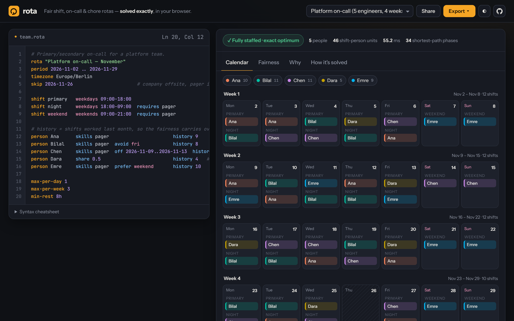
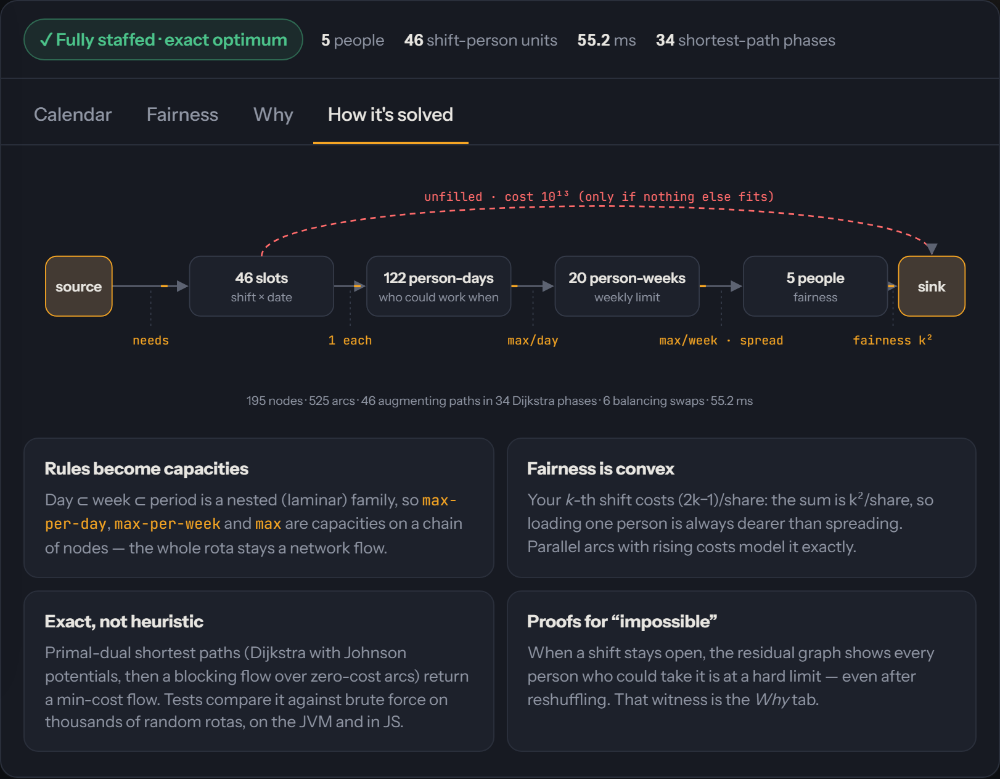
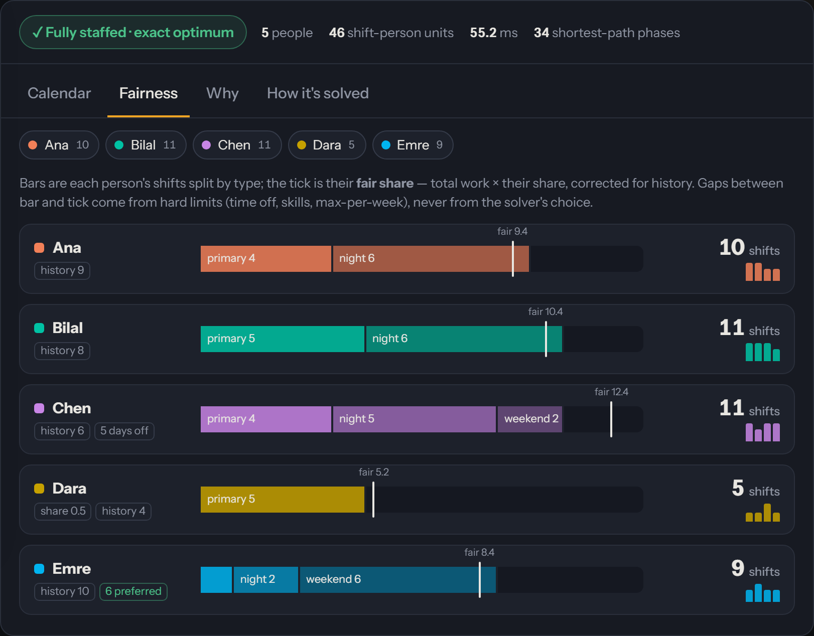
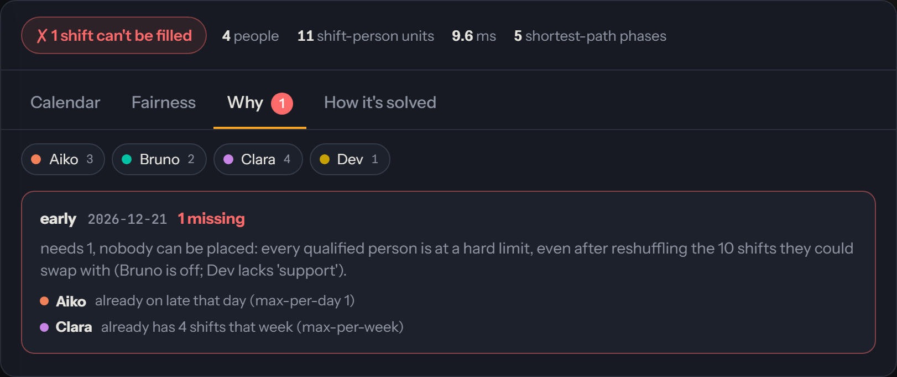

<div align="center">

# ⟳ rota

**"Who's on call this weekend?" shouldn't need a spreadsheet war.** rota turns a few lines of plain
text — shifts, people, time off, skills, preferences — into a rota that is **provably fair**, and when
a rota *can't* be staffed it tells you exactly **why**.

[](https://github.com/ardazeybek-dev/rota/actions/workflows/ci.yml)
[](https://ardazeybek-dev.github.io/rota/)
[-7F52FF?logo=kotlin&logoColor=white)](core/build.gradle.kts)
[](server)
[](LICENSE)

[**Open the playground →**](https://ardazeybek-dev.github.io/rota/) &nbsp;·&nbsp; nothing to install, the solver runs in your browser



</div>

---

## Why

Every team that shares work has a rota: on-call engineers, nurses, café staff, flatmates and the bins.
It's usually built by hand in a spreadsheet, and the same things go wrong every time:

- someone quietly ends up with **twice the night shifts**,
- the part-timer gets a full-timer's load,
- last month's imbalance is forgotten when this month is planned,
- and when two people are on holiday the same week, nobody can say whether the gap is **really
  unavoidable** or just bad planning.

rota fixes this by treating the rota as what it is mathematically — a **min-cost flow problem** — and
solving it **exactly**. Not "a good heuristic": the optimum, checked against brute force.

| | spreadsheet / round-robin | greedy schedulers | **rota** |
|---|:---:|:---:|:---:|
| respects time off, skills, daily & weekly limits | by hand | ✅ | ✅ |
| part-timers get a proportional share | ❌ | sometimes | ✅ exact |
| fairness carries over from last month (`history`) | ❌ | ❌ | ✅ |
| soft wishes (`avoid fri`, `prefer weekend`) | ❌ | ✅ | ✅ |
| **proof** of why a shift can't be filled | ❌ | ❌ | ✅ |
| result is the global optimum | ❌ | ❌ | ✅ |

## Features

- **Plain-text rota files** — a tiny language you can read in a code review. Errors come with line,
  column, a caret and a "did you mean …?" suggestion.
- **Exact solver** — every hard rule is a capacity on a laminar chain of nodes
  (`slot → person-day → person-week → person`), fairness is a convex cost, and a primal-dual
  min-cost-flow returns the true optimum.
- **Explains the impossible** — when a shift stays open, the residual graph gives a min-cut witness:
  *"Clara already has 4 shifts that week, Bruno is on early that day, Aiko is off, Dev lacks
  'support' — even after reshuffling the 10 shifts they could swap with."*
- **Balancing pass that never costs fairness** — among all optimal plans, objective-neutral swaps cut
  short rests (night → early) and mix shift types, so nobody gets *all* the nights.
- **One core, three front ends** — the same Kotlin code runs as a CLI, a Ktor REST server and, compiled
  to JavaScript, in the browser playground.
- **Calendar export** — RFC 5545 `.ics` per person (stable UIDs, so re-importing updates instead of
  duplicating), plus CSV (formula-injection safe) and Markdown.
- **Share links** — the playground compresses the rota into the URL; no server, no account.

## Quick start

### In the browser

Open **[ardazeybek-dev.github.io/rota](https://ardazeybek-dev.github.io/rota/)**, pick an example,
edit the text. Export `.ics` files for everyone from the **Export** menu.

### CLI

Requires JDK 17+.

```bash
git clone https://github.com/ardazeybek-dev/rota.git && cd rota
./gradlew :cli:installDist                  # builds cli/build/install/rota/bin/rota
alias rota=$PWD/cli/build/install/rota/bin/rota

rota init flat -o flat.rota                 # oncall · flat · cafe · impossible
rota solve flat.rota                        # coloured week grids + fairness table
rota solve flat.rota --ics calendars/       # one .ics per person
rota solve flat.rota -f json                # md · csv · json
rota check flat.rota                        # validate only (exit 1 on errors)
```

```text
 Flat 3B chores  2026-11-01 → 2026-11-30  ✓ fully staffed
 53 shift-person units · solved in 22.4 ms · exact optimum · 5 balancing swaps

 week 2     Mon 02    Tue 03    Wed 04    Thu 05    Fri 06    Sat 07    Sun 08
 bins       Lea       ·         ·         Lea       ·         ·         ·
 kitchen    Noor      Marco     Noor      Marco     Noor      Lea       Noor
 bathroom   ·         ·         ·         ·         ·         Marco     ·
 big-clean  ·         ·         ·         ·         ·         ·         Marco
            ·         ·         ·         ·         ·         ·         Sam
 …
 person  shifts  fair   load                 avoided  preferred  by shift
 Lea     15      15.1   ███████████████████░ 2        0          bins:4 kitchen:6 bathroom:3 big-clean:2
 Marco   14      15.1   ██████████████████░░ 0        0          bins:4 kitchen:6 bathroom:1 big-clean:3
 Noor    16      15.1   ████████████████████ 0        16         kitchen:16
 Sam     8       7.6    ██████████░░░░░░░░░░ 0        0          bins:1 kitchen:2 big-clean:5
```

`rota solve` exits with **2** when some shift can't be staffed, so a rota file in a repository can be
checked in CI. A single runnable jar: `./gradlew :cli:fatJar` → `cli/build/dist/rota.jar`.

### Server (REST API + playground)

```bash
cp .env.example .env                        # optional; real env vars override it
./gradlew :server:run                       # http://localhost:8080
# or
docker compose up --build
```

```bash
curl --data-binary @flat.rota localhost:8080/api/solve                        # plan as JSON
curl --data-binary @flat.rota "localhost:8080/api/export/ics?person=Noor" -o noor.ics
```

| Method | Path | Body | Returns |
|---|---|---|---|
| `POST` | `/api/solve` | rota text, or JSON `{"source": "…"}` | `200` plan · `422` with diagnostics |
| `POST` | `/api/export/{ics,csv,md}` | rota text · `?person=` for one calendar | file download |
| `GET` | `/api/examples` | — | the built-in example rotas |
| `GET` | `/api/health` | — | `{"status":"ok"}` |
| `GET` | `/` | — | the playground (same build as GitHub Pages) |

## The rota language

```bash
# Primary/secondary on-call for a platform team.
rota "Platform on-call — November"
period 2026-11-02 .. 2026-11-29          # or: period 2026-11 · period 2026-11-02 for 4 weeks
timezone Europe/Berlin                   # written into the .ics files
skip 2026-11-26                          # holidays: no shifts that day

shift primary   weekdays 09:00-18:00
shift night     weekdays 18:00-09:00  requires pager      # overnight is fine
shift weekend   weekends 09:00-21:00  requires pager  needs 2

person Ana      skills pager                       history 9
person Bilal    skills pager  avoid fri            history 8
person Chen     skills pager  off 2026-11-09..2026-11-13
person Dara     share 0.5                                   # part-time: half the load
person Emre     skills pager  prefer weekend       max 8

max-per-day 1
max-per-week 3
min-rest 8h                              # shorter rests are swapped away where possible, else reported
weight avoid 400                         # fairness · avoid · prefer · spread
```

| Statement | Meaning |
|---|---|
| `shift <name> <days> <HH:MM-HH:MM> [needs N] [requires a,b]` | days: `daily`, `weekdays`, `weekends`, `mon-fri`, `sat,sun`, `fri-mon` |
| `person <name> [share x] [skills a,b] [off d..d,d] [avoid …] [prefer …] [history n] [max n]` | `avoid`/`prefer` take weekdays and/or shift names |
| `max-per-day` / `max-per-week` | hard limits per person |
| `min-rest <hours>` | rest below this is reduced by swaps, then reported |
| `weight <term> <n>` | trade-offs of the objective (defaults: fairness 100, avoid 250, prefer 60, spread 20) |

## How it works



**1. Rules become a network.** Each shift on each date is a *slot* with capacity `needs`. A slot
connects to every *(person, day)* that may work it (not off, has the skill). Person-days feed
*(person, week)* nodes with capacity `max-per-day`; person-weeks feed the *person* with capacity
`max-per-week`. Day ⊂ week ⊂ period is a **laminar** family, which is exactly what keeps all of these
limits inside a plain network flow.

**2. Fairness is convex.** A person's *k*-th shift costs `(2k − 1) / share`, so their total is
`k² / share`: giving a shift to someone who already has more is always dearer. `history` simply starts
*k* where last month ended. The same trick (`n²` per week) spreads shifts across weeks. Convex costs
become parallel unit arcs with increasing costs.

**3. Solve exactly.** Primal-dual min-cost flow: Dijkstra with Johnson potentials finds the shortest
distance, then a Dinic-style blocking flow pushes *every* shortest path of that length before the next
Dijkstra. Every slot also has a bypass to the sink costing 10¹³, so the solver fills as many shifts as
possible first, then optimises fairness — and a slot only uses the bypass when it truly can't be filled.

**4. Explain gaps with a min-cut.** For an unfilled slot, everything still reachable from it in the
residual graph is the set of shifts and people it could trade with, and all their capacities are
exhausted (Hall's theorem). rota reports that set and the limit each person hit.

**5. Polish without losing optimality.** Many plans share the optimal cost. A local search swaps two
people's shifts *inside one week* — which keeps every per-person and per-week count, hence the
objective — only when it lowers short rests or evens out shift types.

<table>
<tr>
<td width="50%"></td>
<td width="50%"></td>
</tr>
<tr>
<td><b>Fairness</b> — shifts by type against each person's fair share (shares and history included).</td>
<td><b>Why</b> — the proof behind an unfillable shift, person by person.</td>
</tr>
</table>

### Verified, not hoped

| Check | Where |
|---|---|
| Solver optimum = **exhaustive search** on 3 000 random rotas (JVM) and 300 (Kotlin/JS on Node) — shares, history, caps, skills, time off, soft wishes, gaps | [`BruteForceTest`](core/src/commonTest/kotlin/dev/rota/BruteForceTest.kt) |
| Optimality certificate: no negative cycle in the residual graph (`--certify`) | [`MinCostFlow`](core/src/commonMain/kotlin/dev/rota/solve/MinCostFlow.kt) |
| `.ics` lines folded at 75 **octets** with CRLF, UTF-8 never split | [`ExportTest`](core/src/commonTest/kotlin/dev/rota/RotaTest.kt) |
| Parser keywords under a Turkish default locale (`FRI` ≠ `frı`) | [`TurkishLocaleTest`](core/src/jvmTest/kotlin/dev/rota/TurkishLocaleTest.kt) |
| REST API, `.env` precedence, body limits | [`ServerTest`](server/src/test/kotlin/dev/rota/server/ServerTest.kt) |

### Performance

`rota bench` builds a synthetic ward (four shift types, skills, leave, preferences, history):

| Team | Period | Shift-person units | Graph | Time (JVM, laptop) |
|---|---|---:|---|---:|
| 20 people | 4 weeks | 132 | 715 nodes · 3.2 k arcs | **~30 ms** |
| 40 people | 13 weeks | 884 | 4.4 k nodes · 21 k arcs | **~340 ms** |
| 80 people | 26 weeks | 3 588 | 17 k nodes · 85 k arcs | ~3.5 s |

The example rotas solve in 15–25 ms in the browser.

## Configuration

The server reads environment variables; a `.env` file in the working directory is loaded first and
real environment variables override it. See [`.env.example`](.env.example).

| Variable | Default | Meaning |
|---|---|---|
| `ROTA_HOST` | `0.0.0.0` | bind address |
| `ROTA_PORT` / `PORT` | `8080` | port (`PORT` wins, for PaaS hosts) |
| `ROTA_MAX_UNITS` | `5000` | largest rota accepted (sum of `needs` over all slots) |
| `ROTA_MAX_BODY_KB` | `256` | largest request body |
| `ROTA_RATE_LIMIT` | `120` | API requests per client per minute; `0` disables |
| `ROTA_CORS_ORIGINS` | *(empty)* | comma-separated origins, or `*` |
| `ROTA_SERVE_WEB` | `true` | serve the playground at `/` |
| `ROTA_LOG_LEVEL` | `INFO` | logback root level |

## Project layout

```
rota/
├── core/                 Kotlin Multiplatform library (JVM + JS)
│   └── src/
│       ├── commonMain/   parser · model · min-cost flow · solver · polish · ics/csv/md
│       ├── commonTest/   brute-force optimality, parser, solver and export tests
│       ├── jsMain/       @JsExport API used by the playground
│       └── jvmTest/      locale test
├── cli/                  `rota` command (Clikt): solve · check · init · bench
├── server/               Ktor REST API + bundled playground, .env config
├── web/                  playground: index.html · style.css · app.js (no framework)
├── docs/                 screenshots
├── Dockerfile            multi-stage, non-root, health-checked
└── .github/workflows/    CI (Linux + Windows, Docker smoke test) · Pages
```

## Development

```bash
./gradlew allTests :server:test :cli:test   # JVM + Kotlin/JS (Node) + server + CLI
./gradlew site                              # static playground → build/site
./gradlew :server:fatJar :cli:fatJar        # runnable jars in */build/dist/
```

Serve `build/site` with any static server that sends `.mjs` as `text/javascript`.
See [CONTRIBUTING.md](CONTRIBUTING.md).

## Known limits & pitfalls

- **Rules that aren't nested stay soft.** "No early shift after a night" crosses day boundaries, so it is
  not a flow capacity; rota reduces it with optimality-preserving swaps (a local search) and reports
  what's left, but can't guarantee the fewest possible.
- **Fairness counts shifts, not hours.** A 4-hour and a 12-hour shift weigh the same; split long
  shifts or use separate rotas when that matters.
- **Times are wall-clock.** DST changes inside a shift are not adjusted; `.ics` files carry the IANA
  `TZID` without an embedded `VTIMEZONE` — Google and Apple Calendar resolve it; strict clients may want one.
- **Kotlin/JS `Long` is emulated** — exhaustive tests run ~70× slower on Node than on the JVM, so the JS
  suite checks fewer seeds. The solver itself still answers in milliseconds.
- **Locale-sensitive JVMs** — on a Turkish default locale, JVM tools that upper-case `i` break; the build
  pins `-Duser.language=en` for Gradle, tests and the start scripts.

## License

[MIT](LICENSE) © Arda Zeybek
